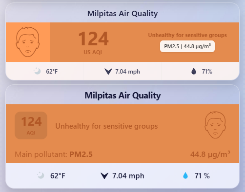

# Air Visual Card

A modern, responsive Home Assistant Lovelace card that displays Air Quality Index (AQI), pollution levels, and weather data in the style of iqair.com. Version 3 is a refactored version that should fix the bugs the users reported in version 2.



[](https://github.com/dnguyen800/air-visual-card/releases)
[](https://github.com/hacs/default)
[](LICENSE)


---

## Features

- 🎨 **Two Card Layouts**:
  - **Modern Layout** (*Default*): The current layout used on iqair.com. Features a sleek, cohesive design with full-width colored air quality status, numerical AQI badge, dynamic font scaling, pollutant grid, and weather metrics bar.
  - **Classic Layout**: The beloved original AirVisual layout with traditional face badges, large numerical AQI, and pill badges.
- Multiple cards supported:
  - Previously adding more than one Air Visual Card would result in an error. That has been fixed now.
- ⚡ **Bi-Directional EPA AQI & Pollutant Interpolation**:
  - **Pollutant $\to$ AQI**: When an AQI sensor is omitted or empty, the card automatically computes the AQI from the **Main Pollutant Value** ($PM_{2.5}$, $PM_{10}$, $O_3$, $NO_2$, $CO$, $SO_2$) using official U.S. EPA linear interpolation. Ideal for direct particulate sensors like openSenseMap, SenseBox, and PurpleAir!
  - **AQI $\to$ Pollutant**: If an integration reports dominant pollutant identity without a numeric concentration sensor, the card calculates the concentration directly from the AQI using EPA concentration breakpoints.
  - **2024 EPA PM2.5 Standards**: Uses the revised U.S. EPA PM2.5 breakpoint scale ($0\text{–}9.0\,\mu\text{g/m}^3 = 0\text{–}50\text{ AQI}$) and official truncation precision.
  - **Automatic Unit Fallback**: Automatically assigns standard EPA units (`µg/m³`, `ppm`, `ppb`) when sensor unit attributes are missing.
- 🪄 **Integration Presets & Auto-Fill in Visual Editor**:
  - One-click configuration presets with smart sensor detection and auto-fill for:
    - **Google Air Quality**
    - **Tomorrow.io** (*includes support for integer pollutant states `0`–`5`*)
    - **openSenseMap / SenseBox**
    - **OpenWeatherMap**
    - **AirVisual (IQAir)**
    - **WAQI (World Air Quality Index)**
- 🌈 **Dynamic Theming**:
  - Card background and face graphics dynamically adjust across the 6 official EPA AQI hazard tiers (Good, Moderate, Unhealthy for Sensitive Groups, Unhealthy, Very Unhealthy, Hazardous).
- 📦 **100% Self-Contained**:
  - Face and weather vector SVGs are embedded directly in the bundle—no external CDN requests or broken icon paths.
- 📐 **Sections & Grid Ready**:
  - Full `getLayoutOptions()` support for Home Assistant's Sections dashboard layout.
- 👆 **Interactive Gestures**:
  - Configurable `tap_action`, `hold_action`, and `double_tap_action` with automatic fallbacks to sensor `more-info` dialogs.
-  **Visual Editor**:
  - Fixed visual editor (previous version had broken it)

---

## Installation

### HACS (Recommended)
1. Open **HACS** in your Home Assistant dashboard.
2. Navigate to **Frontend** and search for **Air Visual Card**.
3. Click **Download**.
4. Refresh your browser dashboard.

### Manual Installation
1. Download [`dist/air-visual-card.js`](https://github.com/dnguyen800/air-visual-card/releases/latest/download/air-visual-card.js) from the latest release.
2. Copy it into your Home Assistant `<config>/www/` directory.
3. Add the resource in **Settings > Dashboards > Resources**:
   ```yaml
   url: /local/air-visual-card.js
   type: module
   ```

---

## Configuration

### Visual Editor
Add an **Air Visual Card** from the Lovelace card picker (`+ Add Card`). Use the visual UI editor to choose your layout, select an integration preset to auto-fill linked sensors, or customize fields manually.

---

### YAML Examples

#### 1. Modern Layout (Default)
```yaml
type: custom:air-visual-card
layout: modern
title: San Francisco
air_quality_index: sensor.u_s_air_quality_index
air_pollution_level: sensor.u_s_air_pollution_level
main_pollutant: sensor.u_s_main_pollutant
main_pollutant_value: sensor.particulate_matter_2_5
weather: weather.home
```

---

## Options Reference

| Name | Type | Default | Description |
| :--- | :--- | :--- | :--- |
| `type` | string | **Required** | `custom:air-visual-card` |
| `layout` | string | `modern` | Card visual layout: `'modern'` or `'classic'`. |
| `integration_preset` | string | `manual` | Auto-fill preset: `google_air_quality`, `tomorrowio`, `opensensemap`, `openweathermap`, `airvisual`, `waqi`, or `manual`. |
| `title` | string | optional | Custom title displayed at the top of the card with no prefixes or suffixes (replaces legacy `city`). |
| `air_quality_index` | string | optional | Entity ID of the Air Quality Index sensor. *If omitted, AQI will be calculated from `main_pollutant_value`.* |
| `main_pollutant_value` | string | optional | Entity ID of the dominant pollutant concentration sensor (e.g. PM2.5, PM10). If left blank, concentration is calculated from the AQI using EPA breakpoints. |
| `main_pollutant` | string | optional | Entity ID of the Main/Dominant Pollutant sensor (e.g. `pm25`, `o3`). |
| `air_pollution_level` | string | optional | Entity ID of the Air Pollution Level description sensor. |
| `weather` | string | optional | Entity ID of a `weather.*` entity for temperature, humidity, and wind conditions. |
| `country` | string | optional | Standard indicator or country label displayed beside AQI (e.g. `US`, `CN`). |
| `unit_of_measurement` | string | `AQI` | Unit of measurement override for the AQI badge. |
| `speed_unit` | string | auto | Wind speed unit override (e.g. `mph`, `km/h`, `m/s`). |
| `hide_title` | boolean | `false` | Hide the card title header. |
| `hide_face` | boolean | `false` | Hide the illustrated face graphic. |
| `hide_weather` | boolean | `false` | Hide the bottom weather conditions bar. |
| `hide_aqi` | boolean | `false` | Hide the numerical AQI badge. |
| `hide_apl` | boolean | `false` | Hide the pollution level text and pollutant information. |
| `tap_action` | object | `more-info` | Action to perform on card click/tap. |
| `hold_action` | object | `more-info` | Action to perform on hold/long-press. |
| `double_tap_action` | object | none | Action to perform on double-tap. |

---

## EPA Breakpoints & Calculations Reference

The card uses official U.S. EPA linear interpolation to convert between pollutant concentrations ($C_p$) and Air Quality Index values ($I$):

$$C_p = \frac{I - I_{Lo}}{I_{Hi} - I_{Lo}} \times (BP_{Hi} - BP_{Lo}) + BP_{Lo}$$

$$I = \frac{I_{Hi} - I_{Lo}}{BP_{Hi} - BP_{Lo}} \times (C_p - BP_{Lo}) + I_{Lo}$$

| AQI Range | Hazard Level | Color | PM2.5 ($\mu\text{g/m}^3$) | PM10 ($\mu\text{g/m}^3$) | O3 (ppm) | CO (ppm) | NO2 (ppb) | SO2 (ppb) |
| :---: | :--- | :---: | :---: | :---: | :---: | :---: | :---: | :---: |
| **0 – 50** | Good | `#009966` | 0.0 – 9.0 | 0 – 54 | 0.000 – 0.054 | 0.0 – 4.4 | 0 – 53 | 0 – 35 |
| **51 – 100** | Moderate | `#ffde33` | 9.1 – 35.4 | 55 – 154 | 0.055 – 0.070 | 4.5 – 9.4 | 54 – 100 | 36 – 75 |
| **101 – 150** | Unhealthy for Sensitive Groups | `#ff9933` | 35.5 – 55.4 | 155 – 254 | 0.071 – 0.085 | 9.5 – 12.4 | 101 – 360 | 76 – 185 |
| **151 – 200** | Unhealthy | `#cc0033` | 55.5 – 125.4 | 255 – 354 | 0.086 – 0.105 | 12.5 – 15.4 | 361 – 649 | 186 – 304 |
| **201 – 300** | Very Unhealthy | `#660099` | 125.5 – 225.4 | 355 – 424 | 0.106 – 0.200 | 15.5 – 30.4 | 650 – 1249 | 305 – 604 |
| **301 – 500** | Hazardous | `#7e0023` | 225.5 – 325.4 | 425 – 604 | 0.405 – 0.504 | 30.5 – 40.4 | 1250 – 1649 | 605 – 804 |

---

## Development

```bash
# Install dependencies
npm install

# Build production bundle
npm run build

# Watch mode for local development
npm run watch
```

---

## Credits

- [custom-cards/boilerplate-card](https://github.com/custom-cards/boilerplate-card) for modern Home Assistant Lovelace card boilerplate and patterns.
- [iqair.com](https://www.iqair.com/) for the original visual card styling and color scales.
- [U.S. EPA Air Quality System](https://aqs.epa.gov/aqsweb/documents/codetables/aqi_breakpoints.html) for air quality index breakpoints and conversion standards.
- Google Gemini used to refactor this card.
