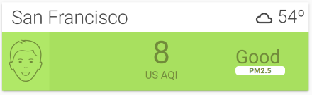

# Air Visual Card

A modern, responsive Home Assistant Lovelace card that displays Air Quality Index (AQI), pollution levels, and weather data in the style of AirVisual.



Built with **Lit 3**, **TypeScript 5**, and following the official [custom-cards/boilerplate-card](https://github.com/custom-cards/boilerplate-card) best practices.

## Features

- **Dynamic Theme Colors**: Card background and face icons adjust automatically across 6 AQI hazard tiers (Good, Moderate, Unhealthy for Sensitive Groups, Unhealthy, Very Unhealthy, Hazardous).
- **100% Self-Contained**: Vector face and weather icons are inlined directly into the bundle (no missing 404 SVGs or separate icon downloads).
- **Modern Visual Editor**: Native `ha-form` schema editor with entity pickers and selectors.
- **Section & Grid Support**: Native `getLayoutOptions()` support for Home Assistant's new Sections dashboard grid.
- **Full Action Handling**: Interactive tap, hold, and double-tap gestures to open more-info dialogs or custom Lovelace actions.
- **Wide Sensor Support**: Works seamlessly with official [AirVisual](https://www.home-assistant.io/integrations/airvisual/), [WAQI (World Air Quality Index)](https://www.home-assistant.io/integrations/waqi/), or custom template sensors.

---

## Installation

### HACS (Recommended)
1. Open HACS in your Home Assistant instance.
2. Go to **Frontend** and search for **Air Visual Card**.
3. Click **Download**.
4. Refresh your dashboard.

### Manual Installation
1. Download [`dist/air-visual-card.js`](https://raw.githubusercontent.com/dnguyen800/air-visual-card/master/dist/air-visual-card.js).
2. Copy it into your Home Assistant directory `<config>/www/air-visual-card.js`.
3. Add the resource in your Dashboard Settings (or `configuration.yaml`):
```yaml
resources:
  - url: /local/air-visual-card.js
    type: module
```

---

## Configuration

### Visual Editor
Add an **Air Visual Card** from the Lovelace card picker and use the UI editor to configure your entities and display toggles.

### YAML Example
```yaml
type: custom:air-visual-card
air_quality_index: sensor.u_s_air_quality_index
air_pollution_level: sensor.u_s_air_pollution_level
main_pollutant: sensor.u_s_main_pollutant
weather: weather.home
city: San Francisco
country: US
hide_title: false
hide_face: false
hide_weather: false
```

### Options

| Name | Type | Default | Description |
| :--- | :--- | :--- | :--- |
| `type` | string | **Required** | `custom:air-visual-card` |
| `air_quality_index` | string | optional | Entity ID of the Air Quality Index sensor (e.g. `sensor.u_s_air_quality_index`). |
| `air_pollution_level` | string | optional | Entity ID of the Air Pollution Level sensor. |
| `main_pollutant` | string | optional | Entity ID of the Main Pollutant sensor. |
| `weather` | string | optional | Entity ID of a `weather.*` entity for temperature, humidity, and wind. |
| `city` | string | optional | City name displayed at the top of the card. |
| `country` | string | optional | Country / standard indicator (e.g. `US`, `CN`). |
| `unit_of_measurement` | string | `AQI` | Unit of measurement override. |
| `speed_unit` | string | auto | Wind speed unit override (e.g. `mph`, `km/h`, `m/s`). |
| `hide_title` | boolean | `false` | Set to `true` to hide the city header title. |
| `hide_face` | boolean | `false` | Set to `true` to hide the face illustration. |
| `hide_weather` | boolean | `false` | Set to `true` to hide the bottom weather forecast bar. |
| `hide_aqi` | boolean | `false` | Set to `true` to hide the numerical AQI badge. |
| `hide_apl` | boolean | `false` | Set to `true` to hide the pollution level text and pollutant badge. |
| `tap_action` | object | `more-info` | Action to perform when tapping the card. |
| `hold_action` | object | `more-info` | Action to perform on hold. |

---

## Development

```bash
# Install dependencies
npm install

# Build production bundle
npm run build

# Watch mode for local development
npm run watch
```

## Credits
- [custom-cards/boilerplate-card](https://github.com/custom-cards/boilerplate-card) for modern Home Assistant card best practices.
- [AirVisual.com](https://www.airvisual.com/) for original visual card styling and color scales.
